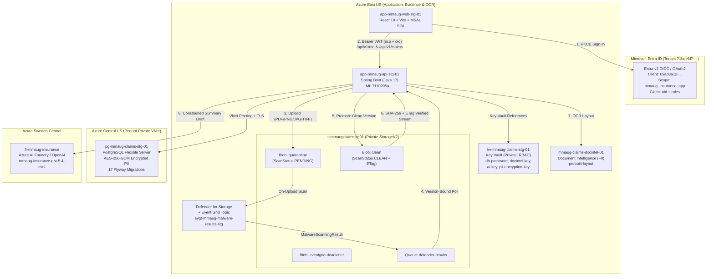

# Phase 2 Solution Design & As-Built Architecture Record — 11 November 2026

## 1. As-Built System Architecture

The diagram below records the implemented architecture across the React 18 SPA, the Java 17 / Spring Boot backend (`mmaug-claims-agent-backend`), private evidence storage and malware scanning, deterministic + LLM grounded analysis, and the multi-region Azure resource group `rg_mmaug_insurance`.

---

## 2. Proposal vs. As-Built Design Reconciliation

| Architectural Area | Original Phase 1 Proposal (18–23 Oct) | As-Built Implementation (11 Nov) | Rationale & Grading Impact |
|---|---|---|---|
| **Application Compute** | Container Apps / App Service alternative noted in System Design v1.1 | Azure App Service Linux (`asp-mmaug-stg`, `app-mmaug-api-stg-01`, `app-mmaug-web-stg-01`) + verified `Dockerfile` in repo | Explicitly permitted in System Design v1.1; reduces fixed container orchestration overhead while preserving container smoke verification in CI. |
| **Backend Runtime** | Python/FastAPI proposed in early draft; team Java implementation retained | Java 17 / Spring Boot (`ClaimsAgentApplication`) with 17 Flyway migrations and 159 automated tests | Provides strong compile-time type safety, JPA `AttributeEncryptor` (AES-256-GCM) for PII, and transaction separation around external provider calls. |
| **Analysis Execution & Queueing** | Asynchronous worker queue proposed for background analysis | Synchronous HTTP execution (`POST /api/v1/claims/{id}/analyse`) backed by durable DB leases (`AgentRunLifecycle`, `ExtractionLeaseRecovery`) and transaction separation (`Propagation.NEVER`); Azure Storage Queue (`defender-results`) dedicated to Defender malware scan events | Eliminates worker-host idle cost while guaranteeing bounded lease recovery, idempotency keys, and zero open DB transactions during OCR/LLM calls. |
| **AI Orchestration & Retrieval (`D03` / `D04`)** | Reviewer asked about multi-agent orchestration and Blob-to-Search indexing | Bounded 11-step coordinator pipeline (`ClaimsAgentOrchestrator`: `SCAN_CHECK` -> `OCR` -> `STRUCTURE` -> `GUARDRAIL` -> `CONSOLIDATE` -> `VALIDATE` -> `TOOL_CALL` -> `VALIDATE` -> `GENERATE_SUMMARY` -> `VERIFY_EVIDENCE` -> `ESCALATION_CHECK`) with `EvidenceVerifier`; private claim evidence is excluded from shared search indexing | Prevents cross-claim data leakage in shared indexes and guarantees every summary statement is verified against exact document extraction IDs or run-scoped tool snapshots. |
| **Infrastructure as Code (`NFR-08–10`)** | Declarative Bicep/Terraform in `infra/` | Validated Bicep template (`infra/staging/main.bicep` + `main.bicepparam`) plus operational PowerShell/Python bootstrap scripts | Closes the declarative IaC requirement while marking `pg-mmaug-claims-stg-01` as `existing` so stateful encrypted data is never overwritten. |

---

## 3. Decision Register Disposition (`D01`–`D07`)

| ID | Decision Topic | Status | Recorded Disposition |
|---|---|---|---|
| **D01** | Scope, Authority & Case Assignment | **Frozen** | Internal `CLAIMS_OFFICER` motor accidental-damage preparation only. No AI approval, rejection, liability, payment, or policy mutation. `ClaimAccessPolicy` enforces strict per-officer isolation via Entra `oid` matching `assigned_officer_id` (fallback `created_by_user_id`). |
| **D02** | Intake Fields & File Rules | **Frozen** | Required completeness fields: `policyNumber`, `claimantName`, `vehicleRegistration`, `incidentDate`, `incidentLocation`, `incidentDescription` (+ `policeReportNumber` when injuries reported). Upload allowlist: PDF, JPG/JPEG, PNG, TIFF verified by magic bytes; max 15 MB/file, 20 files/claim. |
| **D03** | Backend & Agent Orchestration | **Frozen** | Java 17 / Spring Boot deterministic + LLM pipeline (`mmaug-insurance-gpt-5.4-mini` on `fr-mmaug-insurance` in `swedencentral`, fallback `grounded-template-v2`). All LLM statements are constrained to backend-verified facts and citations. |
| **D04** | Retrieval, Tools & Rule Depth | **Frozen** | Case-bound read-only tools (`get_policy`, `get_coverage`, `get_claim_history`, `get_business_rules` v1.0.0) with stored JSON snapshots and SHA-256 hashes. Private claim attachments remain in `quarantine`/`clean` containers and are never indexed into shared search. |
| **D05** | Environment, Regions & Spend | **Recorded** | `rg_mmaug_insurance`: App/Storage/KV/DocIntel in `eastus`, PostgreSQL in `centralus`, AI Foundry in `swedencentral`. Month-to-date spend on 11 Nov is **EUR 86.24** against the **USD 500/month** team ceiling. No destructive resize on `pg-mmaug-claims-stg-01` before retained data/key custody is verified. |
| **D06** | Evaluation, Encryption & Retention | **Frozen** | 20 seeded customers/policies + 12 seeded claims (4 complete, 4 incomplete, 4 conflicting) + 12 evaluation fixtures in `tests/evaluation/live-cases.json`. PII encrypted with 32-byte AES-256-GCM key (`AttributeEncryptor`). Retained database and `pii-encryption-key` version must be preserved—never replaced with a blank DB or fresh key. |
| **D07** | Delivery & Fallback Plan | **Active** | Dual-track execution: live Azure staging dependencies are isolated in scripts (`Grant-StagingBackendAccess.ps1`, `bootstrap_staging_secrets.py`), while a clean local demonstration and reproducible test suite are ready for the Friday 15:00 CET submission window. |

---

## 4. Live Dependency Ownership & Recovery Paths

| Live Dependency | Current State (11 Nov) | Owner Role | Recovery / Fallback Path |
|---|---|---|---|
| **Key Vault & Backend RBAC** | `AccessToKeyVaultDenied` on `kv-mmaug-claims-stg-01`; vault secret list empty | Azure Subscription Admin | Run `scripts/Grant-StagingBackendAccess.ps1` and `scripts/bootstrap_staging_secrets.py` from private VNet context; local demo uses `application-local.yml` with isolated PostgreSQL 18. |
| **Retained PostgreSQL Data & PII Key** | `pg-mmaug-claims-stg-01` Ready (`centralus`), only `postgres`/system DBs listed | Data Owner + Admin | Locate retained dump and original 32-byte `PII_ENCRYPTION_KEY`, verify isolated restore via `scripts/Test-SyntheticDatabaseRestore.ps1`, pin key version in App Service settings. |
| **Defender On-Upload Malware Scan** | Event Grid -> `defender-results` queue Succeeded; on-upload scan toggle `isEnabled=false` | Subscription Security Admin | Enable account-scoped on-upload scan (`capGBPerMonth=1`, topic `evgt-mmaug-malware-results-stg`); local demo uses `StubMalwareScanner` + negative quarantine integration tests. |
| **Entra SPA Redirect & Consent** | API federated OIDC works; Graph app read denied to current CLI user | Entra App Admin | Confirm SPA redirect URI (`https://app-mmaug-web-stg-01...`), delegated scope `mmaug_insurance_app`, and officer role assignments; local demo exercises JWT RBAC tests in `GroundedWorkflowIntegrationTest`. |
